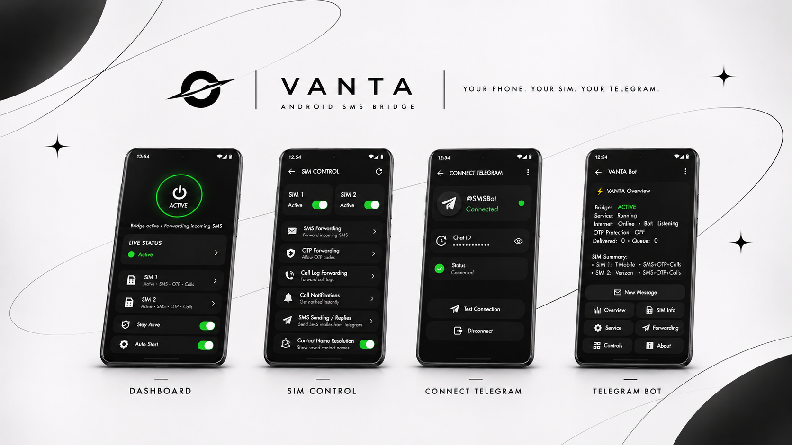
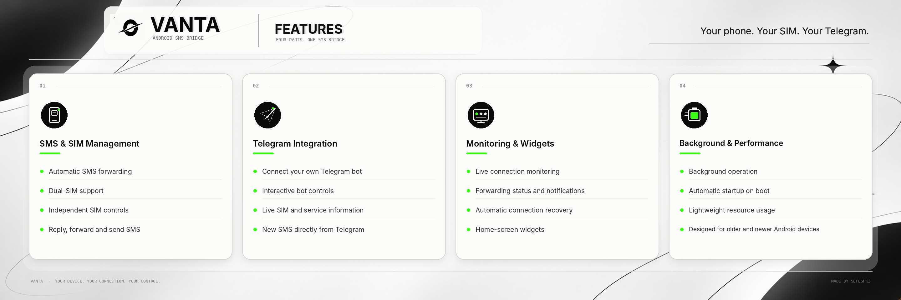

 

**Your phone. Your SIM. Your Telegram.**

An Android app that turns a spare phone into your personal SMS gateway. Incoming messages are forwarded straight to your own Telegram bot.

 

  

[DOWNLOAD](https://github.com/Sefeshki/VANTA/releases/latest) · [SOURCE CODE](https://github.com/Sefeshki/VANTA) · [DEVELOPER](https://github.com/Sefeshki)

---

### What is VANTA?

  

Got an old Android phone? Give it a job.

VANTA turns it into your personal SMS gateway. It runs directly on your phone, forwarding incoming messages to your own Telegram bot without requiring a separate forwarding server or subscription service.

It supports dual-SIM devices, with independent controls for each SIM. It is designed to work across a range of Android devices, including older hardware.

**VANTA is a hands-on Android development project that I have built, tested, debugged, and continuously refined.** My work goes beyond the interface: it includes SMS and telephony integration, SIM management, Telegram API communication, background execution, connectivity monitoring, and message delivery handling. Each of these parts has required implementation work, testing, troubleshooting, and iteration.

---

### Features

  

VANTA supports more than simply forwarding incoming messages.

You can reply to received SMS messages directly through Telegram, forward messages, or start completely new SMS conversations by entering a recipient number. When needed, you can choose which SIM sends the message.

Messages are sent from your phone to your own Telegram bot through the Telegram Bot API, without an additional forwarding service.

---

### How it works

VANTA runs on the Android device that receives the messages.

When an SMS arrives, Android delivers the event to VANTA. The app processes the message and communicates with Telegram through the official Telegram Bot API.

There is no separate VANTA forwarding server involved. The phone handles the forwarding process itself.

VANTA also monitors different parts of its operating state separately:

- **Internet connectivity:** whether the device has a network connection.
- **Telegram connectivity:** whether the Telegram API can be reached.
- **Forwarding service:** whether VANTA's forwarding functionality is active.

When connectivity is interrupted, VANTA attempts to recover automatically.

---

### Engineering & implementation

VANTA is built with Kotlin, Jetpack Compose, and native Android APIs.

Its implementation is organized into components responsible for different parts of the application:

| Component | Responsibility |
|---|---|
| SMS processing | Receiving and processing incoming SMS events |
| SIM management | Detecting SIMs and managing individual SIM settings |
| Telegram integration | Bot communication through the Telegram Bot API |
| Background service | Maintaining the forwarding service |
| Network monitoring | Tracking connectivity and Telegram availability |
| Delivery queue | Managing message delivery operations |
| Telephony integration | Handling outgoing SMS and call-related functionality |

The project brings together Android permissions, telephony APIs, background execution, network handling, message processing, and external API integration.

These systems have to work together reliably, particularly on devices with multiple SIM cards and different Android versions.

---

### Security

  

Security is an important part of VANTA because the application handles personal messages and Telegram bot credentials.

VANTA communicates directly with Telegram through its official Bot API rather than routing messages through a separate forwarding server.

The Telegram bot token is used to authenticate API requests. It should be treated as a secret credential and must never be shared publicly or included in bug reports.

Keep in mind that enabling forwarding means the selected SMS content is transmitted to the Telegram chat associated with your bot. Only enable forwarding for messages you are comfortable sending there.

For security concerns and responsible vulnerability reporting, see [SECURITY.md](SECURITY.md).

---

### Getting started

  

**1. Create your bot**

Open [@BotFather](https://t.me/BotFather), send `/newbot`, choose a name and username, and copy your API token.

**2. Connect VANTA**

Install the app, paste your token into Telegram Setup, verify it, and pair your account using the generated code:

`/start YOUR_CODE`

**3. Grant permissions**

Use **Grant All Permissions** in the Permission Center, or configure permissions individually. Follow the battery optimization guidance too.

**4. Turn it on**

Return to the Dashboard and enable forwarding.

That's it. Your phone is now your SMS bridge.

---

### Updates

VANTA checks GitHub for new releases when the app starts. When an update is available, you'll see an update option in the app.

You can also find the latest version on the [Releases page](https://github.com/Sefeshki/VANTA/releases).

---

### License

VANTA is source-available under the [PolyForm Noncommercial License 1.0.0](https://github.com/Sefeshki/VANTA/blob/main/LICENSE).

Free for noncommercial use. Commercial use requires permission from the author.

See [LICENSE](https://github.com/Sefeshki/VANTA/blob/main/LICENSE) for details.

---

Found a bug, ran into a problem, or have a suggestion? Feel free to open an issue on [GitHub](https://github.com/Sefeshki/VANTA/issues) or message me directly on [Telegram](https://t.me/sefeshki).

---

Made by [Sefeshki](https://github.com/Sefeshki)

[GitHub](https://github.com/Sefeshki/VANTA) · [Releases](https://github.com/Sefeshki/VANTA/releases)

VANTA — Your device. Your connection. Your control.

Built through hands-on development, testing, debugging, and continuous improvement. If you appreciate the work, a <a href="https://github.com/Sefeshki/VANTA">GitHub star</a> helps motivate future development.

