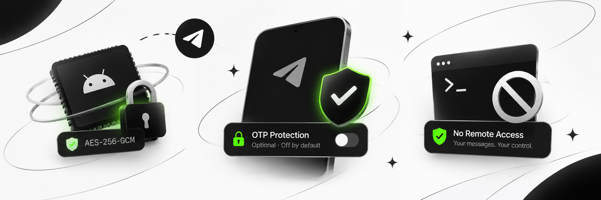
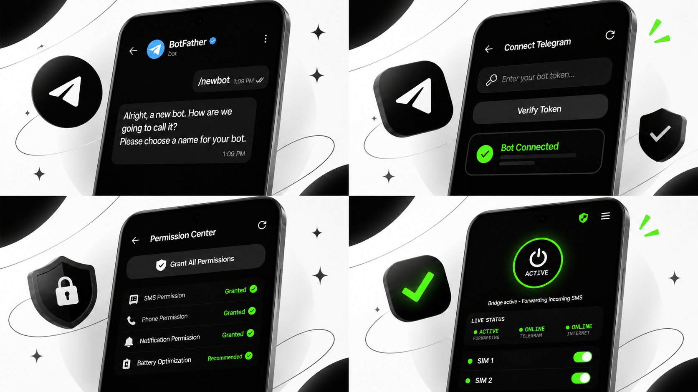

**Your phone. Your SIM. Your Telegram.**

An Android app that turns a spare phone into your personal SMS gateway. Incoming messages are forwarded straight to your own Telegram bot.

 

  

[DOWNLOAD](https://github.com/Sefeshki/VANTA/releases/latest) · [SOURCE CODE](https://github.com/Sefeshki/VANTA) · [DEVELOPER](https://github.com/Sefeshki)

---

### What is VANTA?

  

Got an old Android phone? Give it a job.

VANTA turns it into your personal SMS gateway. It runs directly on your phone, forwarding incoming messages to your own Telegram bot without a separate server or third-party service.

It supports dual-SIM devices, with independent controls for each SIM, and is designed to run efficiently on both older and newer Android phones, keeping resource and battery usage low.

VANTA isn't a vibe-coded project. I've spent a lot of time building, testing, improving, and securing it. Every part has taken real work, and security has been a priority throughout development.

If you like VANTA, all I ask is for a GitHub star—it would motivate me to keep building better, free projects.🤟❤️

---

### Features

  

When you receive an SMS, you can reply to it or forward it directly from Telegram. You can also start a completely new SMS conversation from the bot by entering a recipient number and choosing which SIM to use when needed.

Your messages go straight from your phone to your own Telegram bot, without passing through another forwarding service.

---

### How it works

It's pretty straightforward. Your phone receives the SMS and VANTA sends it directly to your Telegram bot using the official Telegram Bot API.

There is no separate server involved. VANTA keeps track of your internet connection, Telegram connection, and forwarding service separately, so you can see whether everything is actually working.

When a connection drops, VANTA attempts to restore it automatically.

---

### Security

  

I've spent a lot of time working on VANTA's security. Since the app handles personal messages and Telegram bot credentials, this was never something I wanted to overlook.

---

### Getting started

  

**1. Create your bot**

Open [@BotFather](https://t.me/BotFather), send `/newbot`, choose a name and username, and copy your API token.

**2. Connect VANTA**

Install the app, paste your token into Telegram Setup, verify it, and pair your account using the generated code:

`/start YOUR_CODE`

**3. Grant permissions**

Use **Grant All Permissions** in the Permission Center, or configure permissions individually. Follow the battery optimization guidance too.

**4. Turn it on**

Return to the Dashboard and enable forwarding.

That's it. Your phone is now your SMS bridge.

---

### Updates

VANTA checks GitHub for new releases when the app starts. When an update is available, you'll see an update option in the app.

You can also find the latest version on the [Releases page](https://github.com/Sefeshki/VANTA/releases).

---

### License

VANTA is source-available under the [PolyForm Noncommercial License 1.0.0](https://github.com/Sefeshki/VANTA/blob/main/LICENSE).

Free for noncommercial use. Commercial use requires permission from the author.

See [LICENSE](https://github.com/Sefeshki/VANTA/blob/main/LICENSE) for details.

---

Found a bug, ran into a problem, or have a suggestion? Feel free to open an issue on [GitHub](https://github.com/Sefeshki/VANTA/issues) or message me directly on [Telegram](https://t.me/sefeshki).

---

Made by [Sefeshki](https://github.com/Sefeshki)

[GitHub](https://github.com/Sefeshki/VANTA) · [Releases](https://github.com/Sefeshki/VANTA/releases)

VANTA — Your device. Your connection. Your control.

I put a lot of time and interest into building VANTA, and if you like what I've made, a <a href="https://github.com/Sefeshki/VANTA">GitHub star</a> would mean a lot and give me more motivation to keep creating.

